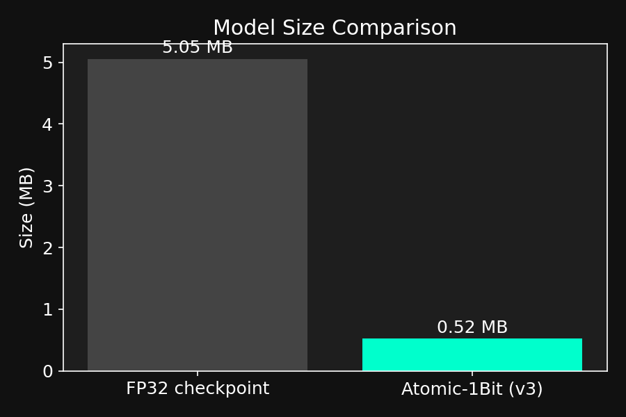
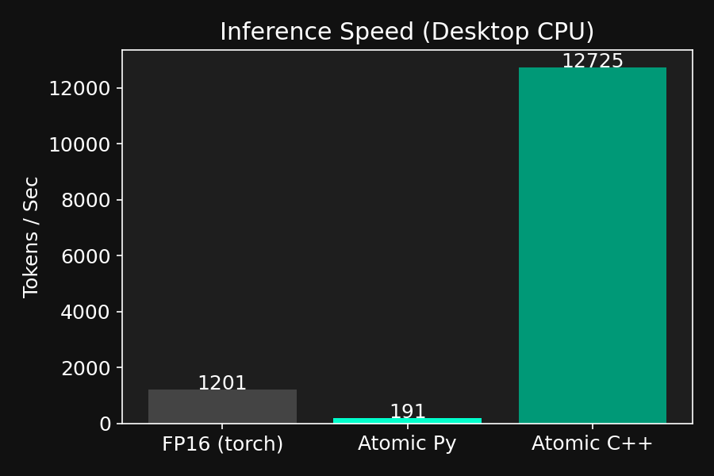
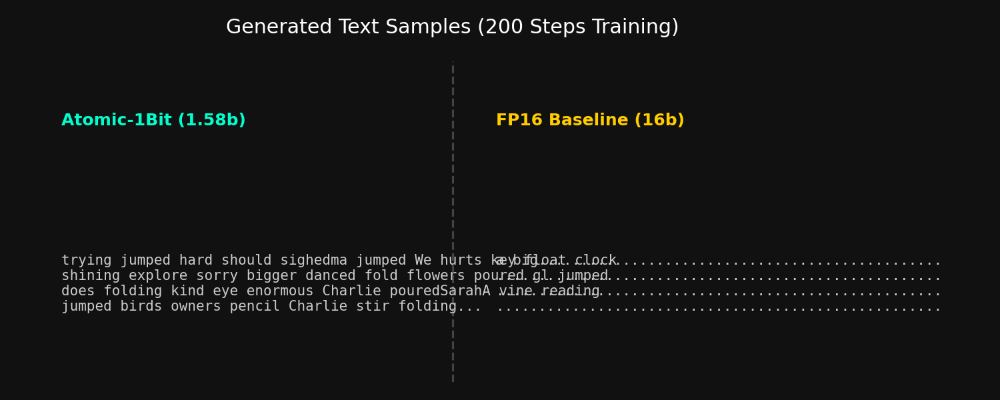
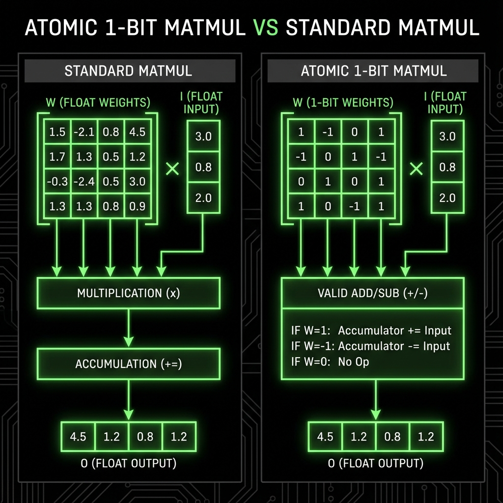

[](https://opensource.org/licenses/MIT)
[](https://www.python.org/downloads/)
[](https://isocpp.org/)
[](#how-it-works)

# Atomic-1Bit

**Run language models using only addition and subtraction.** Atomic-1Bit is a bare-metal inference engine for 1.58-bit ternary models (BitNet b1.58) that replaces floating-point matrix multiplication with integer add/sub operations, cutting model size by over 90% and enabling deployment on devices as small as an ESP32.

## Why Atomic-1Bit?

Most LLM inference requires expensive GPU hardware and gigabytes of memory. Even "small" models assume you have a modern GPU or at least a fast CPU with plenty of RAM.

Atomic-1Bit takes a different approach. By quantizing weights to just three values **{-1, 0, 1}**, we eliminate floating-point multiplication entirely:

```
weight ==  1  ->  accumulator += input
weight == -1  ->  accumulator -= input
weight ==  0  ->  skip  (free sparsity)
```

The result is a full transformer that runs on **integer arithmetic only**. No CUDA required. No FP16. No matrix multiply units. Just `add` and `sub` instructions that work on any processor manufactured in the last 30 years.

**This matters because:**
- A 6.85M parameter model drops from **27.4 MB to 2.6 MB** (-91%)
- The C++ runtime has **zero external dependencies** -- it's a single binary
- It targets a **Raspberry Pi**, an **ESP32**, or a **2015 laptop**
- The ternary kernel is **bit-exact** against the NumPy reference, and the C++
  engine tracks the PyTorch model to float32 precision (see
  [Numerical parity](#numerical-parity))

> This is experimental research software. It works, it's verified, and it's honest about what it is: a proof that useful AI inference doesn't require expensive hardware.

---

## Performance

Benchmarked on Apple M5 Pro (6 P-cores + 12 E-cores), 50 generated tokens,
using the Quick Start config below (256d, 6 layers, 4 heads, 4096 vocab,
6.85M params):

| Metric | FP32 Baseline | Atomic-1Bit | Improvement |
|:---|:---|:---|:---|
| **Model Size** | 27.4 MB | **2.6 MB** | **-91%** |
| **Parameters** | 6.85M | 6.85M | Same |
| **Precision** | Float32 | Ternary {-1, 0, 1} | -- |
| **Throughput (C++)** | N/A | **~3,400 TPS (1 thread) / ~5,500 TPS (8 threads)** | KV-cached decode |

The C++ runner keeps a per-layer KV cache during generation, so each decoded
token costs a single-token forward pass instead of recomputing the full
prefix: per-token cost is O(1) in the number of tokens already generated.
Measured on the config above, throughput holds at ~3.1-3.5k TPS at both 50
and 100 generated tokens single-threaded, where the old recompute-everything
path fell from ~170 to ~83 TPS as the sequence grew. The runner also defaults
to `--threads min(8, hardware_concurrency)`: a persistent pool splits each
ternary matmul's output columns across workers (every output accumulator is
an independent int32 sum, so output is bit-identical for any thread count).
On this machine that lifts the config above to ~5.3-5.6k TPS at 4-8 threads;
the smaller 128d/4L fixture model gains less (~13k -> ~15.5k TPS), and
`--threads 1` keeps the exact serial path. One honest caveat: positions are
learned absolute embeddings, so once the sequence exceeds `context_length`
the window slides and every cached position is rebased, forcing a rebuild of
the cached rows. The slide erases a quarter-window chunk, so the cost is one
rebuild per `context_length/4` tokens rather than per token -- on the trained
1.32M checkpoint that works out to 14.2k TPS inside the window and 5.6k TPS
over a 200-step run that spends most of its steps past it. The Python path
(`AtomicTransformer.generate`) caches the same way. Reproduce with
`benchmarks/run_suite.py`.

<details>
<summary>Visual benchmarks</summary>





</details>

### Quality baseline

Size and speed numbers only matter if the model says something. The repo ships
a small checked-in checkpoint (`checkpoints/tiny_stories.pt`, 1.32M params,
2,000 TinyStories steps, ~2.5 min CPU) so every number below is reproducible
out of the box:

| Metric | Value |
|:---|---:|
| Held-out perplexity | **115.5** |
| Uniform baseline (learned nothing) | 2048 |
| Distinct trigram ratio | 0.84 |
| 5-gram repetition rate | 0.003 |

Sampled from the C++ engine at `temp 0.9, seed 13`, reading a 533 KB packed
binary (`--vocab checkpoints/tiny_stories.vocab`):

```
would day and Max gave walk child. bark ran, friends day was excited looked
so She Ben to. in the".. wanted Joe to he her
```

That is the honest state of it: TinyStories words and fragments with local
grammar, but not a story. The fixture exists so parity checks and quality
evals run instantly -- `python3 tools/parity_check.py` -- and longer training
on the bigger presets (`stories_base`, `flagship_12m`) is the path to better
samples. Checkpoints produced by `python3 atomic_1bit/training/train.py` land
in `weights/`, which is gitignored.

---

## Quick Start

### Prerequisites

- Python 3.8+
- GCC/G++ or Clang (for C++ inference, C++17 support required)
- macOS (Apple Silicon recommended) or Linux

### Install

```bash
git clone https://github.com/guirguispierre/Atomic-1Bit.git
cd Atomic-1Bit
pip install -r requirements.txt
```

### Build the ternary kernel

The Python inference path loads a shared library, `libatomic.so`. It builds
itself automatically the first time it is needed (via `make` in
`atomic_1bit/core/`), or you can build everything -- kernel plus the C++
runner -- and prove the install in one shot:

```bash
make verify    # builds libatomic.so + embedded/runner, checks parity, runs the demo
```

The kernel needs make and a C++17 compiler; if the automatic build fails,
the import error says exactly what to run.

### Verify the kernel works

This confirms the C++ ternary kernel matches the Python/NumPy reference exactly:

```bash
python3 atomic_1bit/python/inference.py
# Expected: ">> SUCCESS: Kernel Output Matches Reference."
```

### Train a model

```bash
# Train on TinyStories dataset (~15k steps)
python3 atomic_1bit/training/train.py
```

### Export and run on bare metal

```bash
# Export trained model to binary
python3 atomic_1bit/utils/export_to_cpp.py \
  --model weights/stories_final.pt \
  --output embedded/atomic_model.bin \
  --dim 256 --depth 6 --heads 4 --vocab_size 4096 --context_len 128

# Compile the C++ engine
cd embedded
g++ -O3 -std=c++17 atomic_runner.cpp -o runner

# Generate text
./runner --model atomic_model.bin --steps 100 --temp 0.7 --seed 42 --start_token 58

# Or decode to real words with a .vocab file (tools/make_vocab.py);
# the repo ships one for checkpoints/tiny_stories.pt
./runner --model atomic_model.bin --steps 100 --temp 0.7 --seed 42 \
  --vocab ../checkpoints/tiny_stories.vocab
```

See [docs/COMMANDS.md](docs/COMMANDS.md) for the full command reference and [docs/INSTALL.md](docs/INSTALL.md) for detailed installation instructions.

---

## How It Works

Atomic-1Bit implements a standard transformer architecture (embeddings, multi-head attention, feed-forward layers) with one critical difference: every linear layer uses **BitLinear** instead of `nn.Linear`.

During training, weights are quantized to {-1, 0, 1} using a straight-through estimator (STE), which lets gradients flow through the discrete quantization step. Activations are quantized to INT8. At inference time, the entire forward pass reduces to integer additions and subtractions.

The project has three components:

1. **Research stack** (`atomic_1bit/`) -- PyTorch training, evaluation, and model architecture. Train on TinyStories or Alpaca-cleaned datasets with thermal safety monitoring, gradient accumulation, and cosine scheduling.

2. **Bare-metal runtime** (`embedded/`) -- Standalone C++ inference engine with zero dependencies. Supports CPU, Metal (Apple Silicon), and CUDA backends through conditional compilation.

3. **Gist tokens** -- Pre-computed "thought vectors" that compress a system prompt into a single embedding, injected into the attention stream at zero inference cost.

### Numerical parity

Two different guarantees are worth separating, because only one of them is exact:

| Claim | Status | Verified by |
|:---|:---|:---|
| C++ ternary kernel == NumPy int32 reference | **Bit-exact** | `tests/test_kernel_parity.py` |
| C++ engine == PyTorch model, whole forward pass | Agrees to float32 precision | `tests/test_cpp_runtime_parity.py` |

Whole-model bit-equality is *not* achievable by design, and the reason is worth
knowing before you go hunting for a bug. Activations are quantized with a
per-tensor scale derived from a max over float values. `round()` is
discontinuous, so a last-ULP difference anywhere upstream -- summation order in
an RMS norm, a `tanh` implementation -- can push one value across a `.5`
boundary. That shifts a single int8 by one step, which is a *discrete* jump in
the accumulator, not an epsilon. Deeper models give this more chances to happen.

In practice a shallow model matches PyTorch to ~1e-7 relative, and deeper ones
stay within a few percent with the same next-token prediction. Greedy decoding
can still fork after enough steps once two logits are near-tied. The test suite
pins both bounds, so a genuine mismatch -- a different activation function,
scale convention, or weight layout -- fails loudly instead of hiding in the
noise.



For more details, see [docs/USAGE.md](docs/USAGE.md).

---

## Project Structure

```
atomic_1bit/
  model/          Transformer architecture (BitLinear, BitAttention)
  nn/             Core layers (BitLinear with STE quantization)
  training/       Training scripts (TinyStories, Alpaca, Pocket)
  evaluation/     Quality metrics (perplexity, coherence, diversity)
  python/         Python inference, chat interface, kernel wrapper
  utils/          Export, gist generation, thermal monitoring
  core/           C++ kernels (CPU, Metal, CUDA backends)
  tokenizers/     Tokenizer abstraction layer
  config.py       YAML/JSON configuration system
embedded/         Standalone C++ runner + ESP32 port guide
configs/          Model presets (4K pocket to 12.5M flagship)
benchmarks/       Reproducible benchmark suite vs FP16 baselines
tests/            179 pytest tests for correctness verification
scripts/          Plotting, evaluation, and reproduction scripts
docs/             Installation, usage, commands, benchmarking guides
examples/         Runnable example scripts
```

---

## Model Configurations

| Config | Parameters | Exported size | Dimensions | Use Case |
|:---|:---|:---|:---|:---|
| [`pocket_4k`](configs/pocket_4k.yaml) | 5.28M | 2.2 MB | 256d, 4L, 4H, 4K vocab | Smallest preset |
| [`stories_base`](configs/stories_base.yaml) | 6.85M | 2.6 MB | 256d, 6L, 4H, 4K vocab | Development / testing |
| [`flagship_12m`](configs/flagship_12m.yaml) | 12.5M | 4.2 MB | 320d, 8L, 5H, 4K vocab | Quality demos |
| [`mixed_precision`](configs/mixed_precision.yaml) | Configurable | -- | Hybrid 1.58/4-bit | Experimental |

Exported sizes are format v3, measured on this repo: ternary weights are
packed four per byte and each embedding row is stored as int8 codes with a
float32 absmax scale, so total parameters -- and still vocabulary size more
than depth -- drive the file. `stories_base.yaml` uses the same 4096-entry
vocabulary as the Quick Start, giving a 6.85M-parameter model that exports to
2.6 MB; the v2 layout with float32 embeddings was 5.8 MB. Set the vocabulary
deliberately for your target.

All three presets now fit 8 MB ESP32 flash. None fits in SRAM -- loaders
dequantize embeddings to float32, so RAM cost is unchanged -- and on-device
inference still streams weights from flash: see
[embedded/ESP32_PORT_GUIDE.md](embedded/ESP32_PORT_GUIDE.md).

Load any config with:

```python
from atomic_1bit.config import load_config, config_to_atomic
config = config_to_atomic(load_config("configs/stories_base.yaml"))
```

---

## Requirements

| Dependency | Version | Purpose |
|:---|:---|:---|
| Python | 3.8+ | Training and evaluation |
| PyTorch | >= 1.13.0 | Model training |
| tiktoken | >= 0.5.0 | Tokenization |
| datasets | >= 2.14.0 | HuggingFace datasets |
| NumPy | >= 1.24.0 | Reference math |
| matplotlib | >= 3.7.0 | Benchmark plots |
| psutil | >= 5.9.0 | Thermal monitoring |
| tqdm | >= 4.65.0 | Progress bars |
| PyYAML | >= 6.0 | Config files |
| GCC/Clang | C++17 | C++ inference engine |

**Hardware**: Any machine with a CPU. Apple Silicon recommended for Metal backend. NVIDIA GPU optional for CUDA backend. ESP32 firmware compiles under PlatformIO (`esp32dev`); its on-device code is a loader/inference proof of concept, not a verified production port.

---

## Running Tests

```bash
pip install pytest

# Run the full test suite
pytest tests/ -v

# Run specific test modules
pytest tests/test_bitlinear.py -v
pytest tests/test_kernel_parity.py -v
```

Two modules need compiled artifacts and skip without them:
`test_kernel_parity.py` needs `make -C atomic_1bit/core`, and
`test_cpp_runtime_parity.py` needs the runner
(`cd embedded && g++ -O3 -std=c++17 atomic_runner.cpp -o runner`). Build both
before trusting a green run.

---

## Contributing

We welcome contributions. See [CONTRIBUTING.md](CONTRIBUTING.md) for guidelines on submitting issues, pull requests, and code style expectations.

---

## Roadmap

See [ROADMAP.md](ROADMAP.md) for the full development plan and [CHANGELOG.md](CHANGELOG.md) for per-release detail.

- **v1.0** -- Parity-verified ternary inference (done)
- **v1.2** -- Hardware-native backends: Metal, CUDA, NEON/AVX2 SIMD (done)
- **v1.3** -- Model scaling, evaluation harness, 12.5M config (done)
- **v1.4** -- Format-correct C++ deployment, top-p / top-k sampling, robust CLIs (current)
- **Next** -- Mobile demos, mixed-precision training, HTTP serving wrapper

---

## License

MIT License. See [LICENSE](LICENSE) for details.

## Contact

- **Author**: [@guirguispierre](https://github.com/guirguispierre)
- **Issues**: [GitHub Issues](https://github.com/guirguispierre/Atomic-1Bit/issues)
- **Discussions**: [GitHub Discussions](https://github.com/guirguispierre/Atomic-1Bit/discussions)
